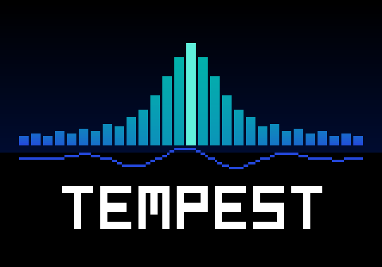
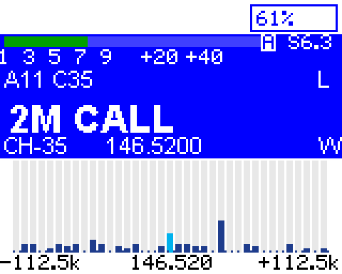
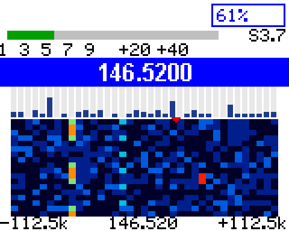
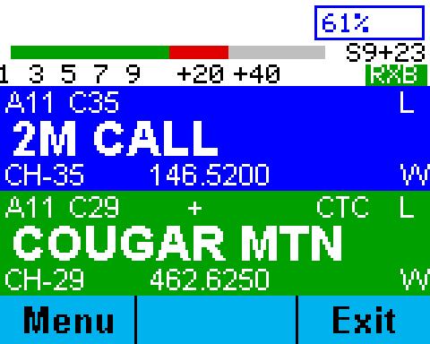
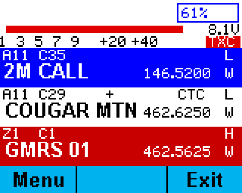
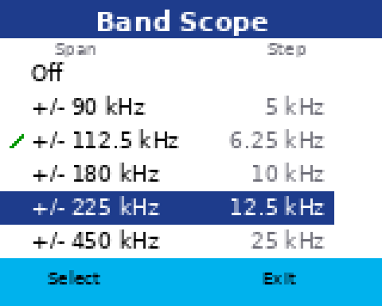
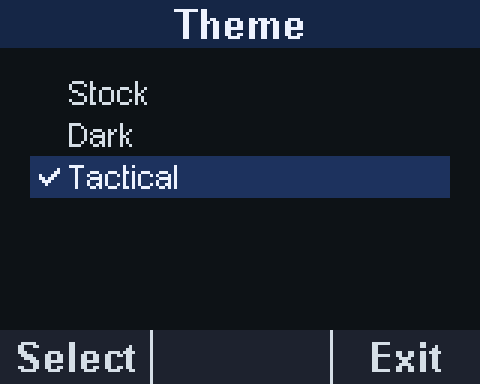
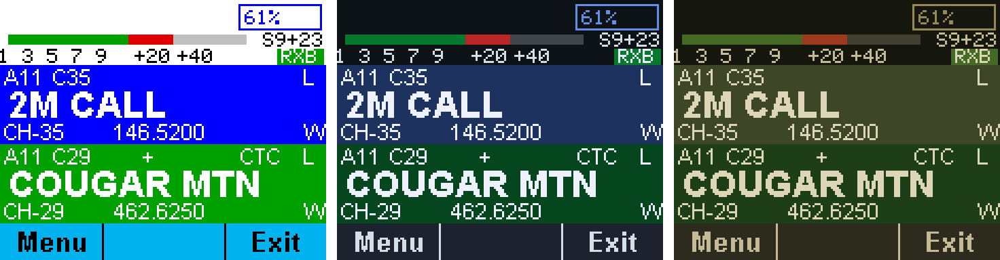

  

<h1 align="center">Tempest</h1>

<b>Firmware modifications for popular handheld radios.</b> 
S-meter, band scope, waterfall, a third VFO, themes and more, flashed straight from your browser.

<a href="https://tempitor.github.io/Tempest/ha1g/"><b>Open the HA1G flasher</b></a> · <a href="https://github.com/Tempitor/Tempest/blob/main/ha1g/README.md">HA1G guide</a>

Each mod is applied in your browser to the radio's **stock firmware file, which you download
from the manufacturer**. This repository contains no manufacturer firmware.

| Radio | Current release | Flasher | Guide | Video |
|---|---|---|---|---|
| Retevis / Ailunce HA1G | HA1G v1.0.1 (build D022) | [Open the flasher](https://tempitor.github.io/Tempest/ha1g/) | [HA1G guide](https://github.com/Tempitor/Tempest/blob/main/ha1g/README.md) | [Watch on YouTube](https://youtu.be/S8D3sTKIlws) |
| Retevis / Ailunce HA1UV | Coming soon (Dec. 2026). [Early access for patrons](https://www.patreon.com/Tempest5978/posts/tempest-for-176574356) | | | |
| Retevis / Ailunce HA2 | Coming soon (Dec. 2026) | | | |

You need Chrome or Edge on a computer (Web Serial) and the radio's programming cable.

**Versions.** Each radio has its own release line, tagged like `ha1g-v1.0.0`: the major number
changes with a new stock base firmware or a breaking change, the minor number with new features,
and the patch number with fixes only. The radio's Radio Information screen shows the build
number (for example `D020`), and each release says which build it contains.

## Features (HA1G)

<table>
<tr>
<td width="50%" valign="top"> 
<b>S-meter and band scope.</b> A signal bar from S1 to S9+40 with a reading such as <code>S6.3</code>, and a row of bars showing activity around your frequency. The scope only sweeps while your channel is quiet.</td>
<td width="50%" valign="top"> 
<b>Waterfall.</b> A scrolling spectrum history with a marker that follows the strongest signal. In frequency mode, the knob moves the marker and <b>Menu</b> tunes to it. A long press on <code>0</code> cycles Bars, Waterfall and Off.</td>
</tr>
<tr>
<td valign="top"> 
<b>Dual and triple VFO.</b> Band C is added, and <code>#</code> switches between single, dual and triple views. The receiving VFO's panel turns green. With the scope off, the VFO cards grow to fill the screen.</td>
<td valign="top"> 
<b>Side Key PTT.</b> In the dual and triple views, the side keys can transmit on the other VFOs without changing your selection. The transmitting panel turns red and the meter shows power and battery.</td>
</tr>
<tr>
<td valign="top"> 
<b>Scope width.</b> Choose ±90 to ±450 kHz in Radio Setting → Band Scope. The page shows the step between bars, and your choice is remembered.</td>
<td valign="top"> 
<b>Themes.</b> Radio Setting → Theme picks Stock, Dark or Tactical. Your choice is saved across power-off. The radio also boots with the Tempest logo shown at the top of this page.</td>
</tr>
</table>

**Themes.** Stock, Dark and Tactical (shown left to right). The whole screen follows the theme,
including the stock menus. Choose it in Radio Setting → Theme.

**Fixes.** Monitor opens the squelch on every channel, and Talk Around / Freq Reversal now show
the right frequency. Your channels and settings are kept, and CHIRP and the Retevis CPS still
recognize the radio. The [HA1G guide](https://github.com/Tempitor/Tempest/blob/main/ha1g/README.md) has the full list, keys and flashing steps.

Screens are renderings of the 160×128 display using the radio's own fonts and the firmware's
theme colors, with test data. They are not photos of a live radio.

Use at your own risk: these are unofficial modifications, not supported by the radio makers,
and may void your warranty. Transmit only within your license and local rules.

## License

Tempest is free software, licensed under the **GNU General Public License v3.0 or later**
([LICENSE](LICENSE)). You can use, study, share and change it, and if you share a changed
version you must share its source under the same license.

**Source code:** the HA1G source, with a script that rebuilds the release from your stock file, is
in [ha1g/src](https://github.com/Tempitor/Tempest/tree/main/ha1g/src).

**Other licensing:** the author also offers Tempest under separate terms, for example to radio
manufacturers who want to build it into their products. To ask, open an issue or contact
[@Tempitor](https://github.com/Tempitor).

Want to contribute? See [CONTRIBUTING.md](CONTRIBUTING.md). Contributions need a sign-off that
keeps this dual licensing possible.

This repository contains no manufacturer firmware. Tempest is not affiliated with or endorsed by
Retevis, Ailunce or any radio maker. See [NOTICE](NOTICE).

## Support Tempest

Tempest is free and will stay free. If you find it useful and want to help, you can support
development on [Patreon](https://www.patreon.com/17195448/join). It is completely optional.
